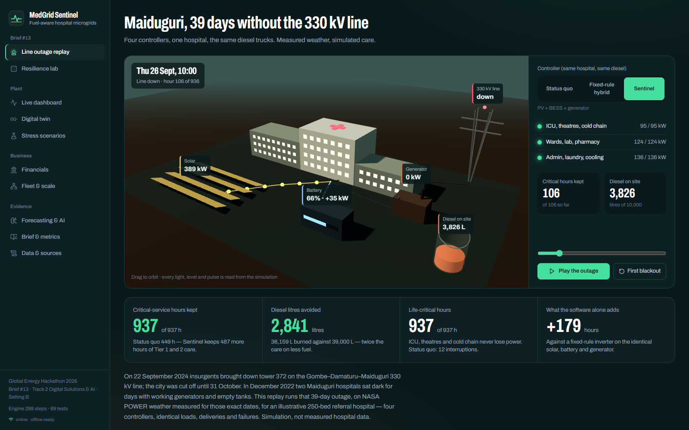
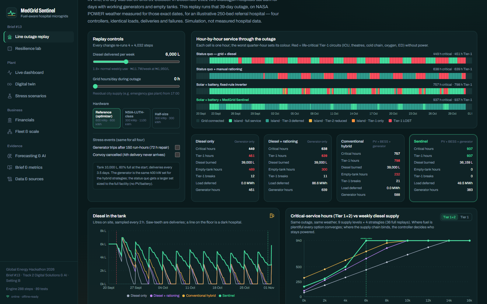
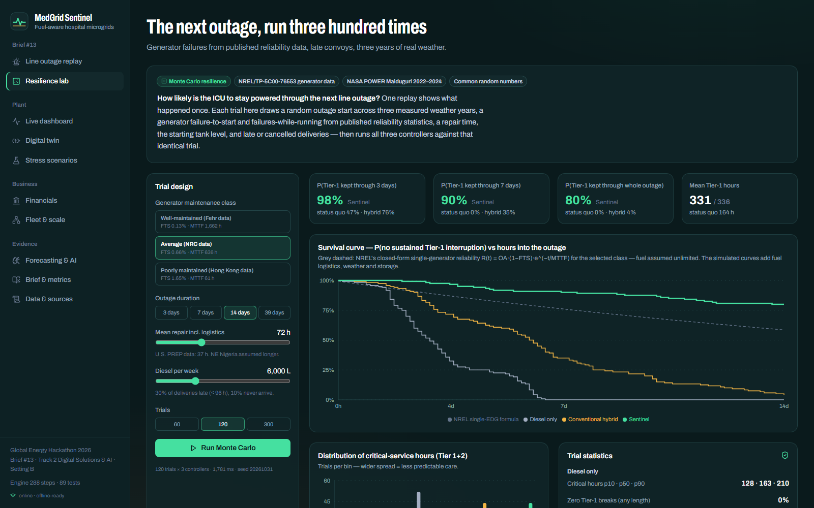
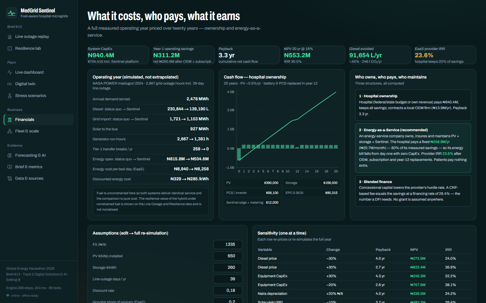
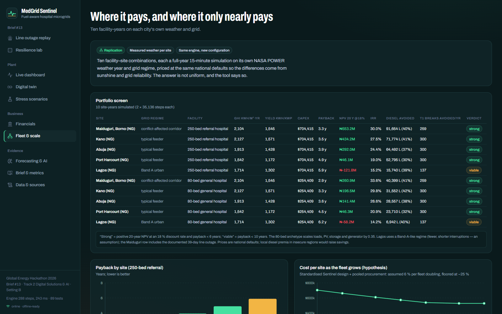
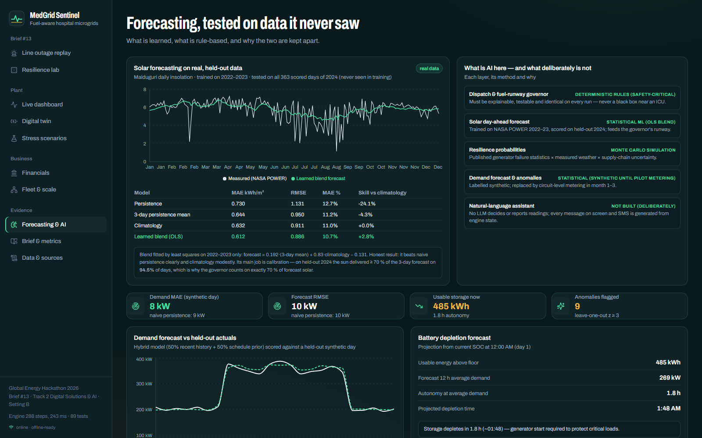

# MEDGRID SENTINEL

**Intelligent Hospital Microgrids. Predictive Energy Resilience. Uninterrupted Critical Care.**

> *The generator works. The fuel doesn't come.* In a city the grid can't protect, critical care ends when the diesel ends. MedGrid Sentinel is a hospital-microgrid digital twin with a fuel-aware predictive controller: it turns every litre the sun saves into hours of critical care.

Anneru IAS **Global Energy Hackathon 2026** · **Brief #13 — Power for a city the grid can't protect** · **Track 2 — Digital Solutions & AI** · **Setting B — Non-residential (healthcare)** · solo entry: Jackson Sixtus Abetianbe

**Brief success metric (Handbook Appendix B, verbatim):** *"Hours of critical service maintained during a line outage, and diesel litres avoided."*

---

## The result (every number below is generated by `npm run results` → [`results/demo-results.json`](results/demo-results.json))

**Brief #13 replay — the real 39-day Maiduguri line outage** (Gombe–Damaturu–Maiduguri 330 kV line vandalised 22 Sep 2024, restored 31 Oct 2024), NASA POWER measured weather for those dates, illustrative 250-bed referral hospital, 6,000 L/week diesel delivered (1.8× its normal-year use), 10,000 L tank. Four controllers see identical loads, weather, deliveries and failures:

| Controller | Hardware | Critical-service hours (Tier 1+2) | Tier-1 hours | Diesel | Empty-tank hours | Tier-1 breaks |
|---|---|---:|---:|---:|---:|---:|
| Status quo | 450 kW generator | 449 / 937 | 451 | 39,000 L | 489 | 12 |
| Status quo + manual rationing | 450 kW generator | 638 | 639 | 39,000 L | 300 | 11 |
| Fixed-rule hybrid inverter | 600 kWp PV + 600 kWh LFP + 400 kW gen | 757 | 798 | 39,000 L | 232 | 21 |
| **MedGrid Sentinel** | **same as above** | **937 / 937** | **937** | **36,159 L** | **0** | **0** |

- **Metric 1:** 449 → **937 critical-service hours** (+487 h, +108%), Tier-1 life-critical load never interrupted.
- **Metric 2:** **2,841 L avoided** in the outage while delivering 2× the service; **91,654 L/yr avoided (−39.7%)** across a full measured year; 246 t CO₂/yr.
- **Same hardware, different brain:** +179 critical hours vs a fixed-rule hybrid inverter on identical PV + battery.
- **Next outage (300-trial Monte Carlo, 14-day outage, NREL average-reliability generator, late/missed deliveries):** P(Tier-1 powered for 14 days) **0% status quo → 3% fixed-rule hybrid → 78% Sentinel** (91% with a well-maintained generator).
- **Economics (full measured year, 20-year lifecycle):** CapEx **$704k (₦940M)**, savings ₦311M/yr, **payback 3.3 years, IRR 30%**, NPV ₦553M at 18%. Under Energy-as-a-Service the hospital pays **₦20.7M/month** with zero CapEx and keeps 20% of savings from month one (provider IRR 23.6%). Same model as the real NSIA-LUTH cancer-centre microgrid (EM-ONE/RIPLE, 2025).
- **Low-bandwidth:** fully offline static web app; duty-engineer alerts as single-segment SMS (≤160 GSM-7 chars) + USSD status menu.

Simulation, not field-measured performance. The hospital is an illustrative reference model; no named hospital's data is used.

## Screens (real captures from `npm run e2e`)

| | |
|---|---|
|  |  |
|  |  |
|  |  |

## What is new (the root cause others miss)

Hospital backup is sized in **kW** and run on fixed rules. But a multi-week line outage is an **energy-logistics** problem: diesel need roughly quadruples while deliveries, budgets and convoys stay flat (Dec 2022: two Maiduguri hospitals sat dark for days with working generators and empty tanks). Sentinel decides, every hour and with stated arithmetic, which care tiers the remaining litres protect:

1. **Fuel-runway governor:** diesel + battery + forecast solar vs each service level's energy need until the next *expected* delivery (+24 h margin). It defers Tier 3 (HVAC, laundry, admin) first and Tier 1 never. Surplus solar that would be curtailed is always given back to deferred loads.
2. **Clinical ride-through reserve:** the battery never drops below 2 h of Tier-1 while the generator is off, and the battery inverter forms the island instantly. 259 → 0 Tier-1 transfer breaks per year.
3. **Efficient generator cycling:** the set runs hard (load + charging) and stops when the battery is full. Generator hours fall 2,667 → 1,381 per year.

The software's value is **isolated**: all four controllers share one physics engine and identical inputs. Planning tools (HOMER, REopt) size systems for analysts; hybrid inverters dispatch on fixed rules. Neither schedules *care tiers* against the *next fuel convoy*.

## Evidence & validation

- **Real data:** NASA POWER hourly irradiance + temperature (Maiduguri 2022–24, 7 more sites); NREL/TP-5C00-76553 generator failure statistics; World Bank Enterprise Survey outage frequency; NERC tariff; Oct-2026 diesel and FX. See [docs/DATA_SOURCES.md](docs/DATA_SOURCES.md).
- **89 automated tests** (`npm test`), including power balance at every step for every strategy (including fuel-limited and failure steps), diesel mass conservation, reproduction of NREL's "well-maintained generator ≈ 80% reliable over two weeks", the 15-second transfer-break physics, and Monte Carlo determinism and dominance.
- **ML on held-out data:** the solar forecaster is trained on 2022–23 and tested on 2024 (RMSE 0.886 kWh/m²/day, 22% better than persistence). It also calibrates the governor: on held-out days the sun delivered ≥70% of forecast on 94.5% of them.
- **E2E:** `npm run e2e` drives every tab in headless Chrome, including an in-browser Monte Carlo and sizing search, with zero console errors and no mobile overflow.

## Run it

```bash
npm install          # Node ≥ 18.17
npm test             # 89 engine tests (vitest)
npm run results      # regenerate results/demo-results.json (≈45 s)
npm run build        # static export to out/ (no server needed)
npm run serve        # http://localhost:3003  — works offline once loaded
npm run e2e          # headless-Chrome walkthrough + screenshots (needs `npm run serve`)
```

Deck and summary: `node scripts/make-deck.mjs` (then LibreOffice → PDF) and `python scripts/make-onepager.py`. Both read only `results/demo-results.json`.

## Architecture

```
src/data/irradiance/   NASA POWER hourly GHI + T2M (10 site-years), converted by scripts/build-weather-data.py
src/engine/            Deterministic simulation core — no UI, no network, fully unit-tested
  dispatch.ts            15-min step: grid state machine, 4 strategies, governor, fuel, failures, transfer gaps
  simulate.ts            orchestration, metrics (strict maintained-hours), strategy comparison
  scenarios.ts           reference design, Brief #13 Maiduguri replay, 10 legacy stress scenarios
  resilience.ts          Monte Carlo (common random numbers, NREL reliability classes, supply-chain shocks)
  financial.ts           full-year economics, 20-yr lifecycle, EaaS provider IRR, sensitivity
  forecast.ts            solar forecaster on held-out real data; demand/anomaly tools
  sizing.ts · fleet.ts   NPV-ranked sizing under brief-metric feasibility; 10 site-year portfolio
  alerts.ts              GSM-7 SMS feed + USSD screen
src/components/        Next.js UI (Line Outage, Resilience Lab, Dashboard, Twin, Scenario Lab, Financials, Fleet, Intelligence, Brief, Sources)
scripts/               results, deck, one-pager, disclosure, E2E, static server
docs/                  methodology, sources, standards, financial & business model, roadmap, risks, judge Q&A, rubric self-assessment
submission/            deck (pptx+pdf), one-page summary (pdf+md), disclosure (txt+pdf), portal text, video scripts & runbooks
```

## Honest limitations

Loads are an illustrative reference profile; the outage replay assumes the hospital feeder was dark for the full 39 days (Maiduguri town was partly fed by an emergency gas plant, and a slider models residual supply); fuel logistics and repair times are explicit assumptions; it's a simulation, not certified protection or control. The full list is in [docs/ASSUMPTIONS_AND_LIMITATIONS.md](docs/ASSUMPTIONS_AND_LIMITATIONS.md). The product is decision support plus a supervisory controller design; in the pilot it runs in shadow mode before it dispatches anything.

## Disclosure

Nothing existed before the sprint. Day 1 was built with the ZCode AI coding agent; Day 2 was rebuilt with Claude Code (Anthropic). Open-source libraries and NASA POWER data are listed in [submission/DISCLOSURE_STATEMENT.txt](submission/DISCLOSURE_STATEMENT.txt).
