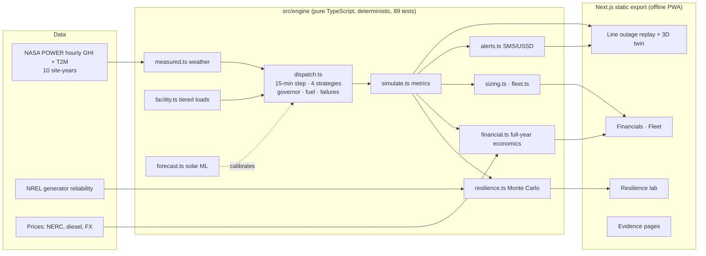
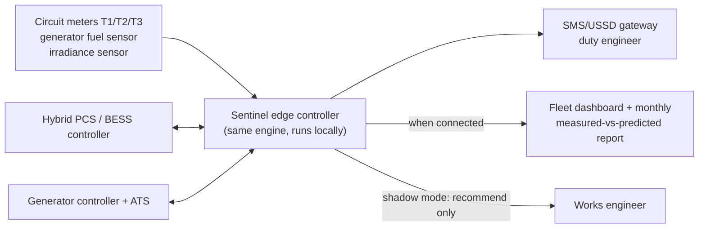

# System Architecture

## 1. Prototype (this repository)

- **No server, no API keys, no runtime network.** The engine and its data ship in the static bundle (≈ 450 kB first load; 3D model lazy-loaded), and a service worker makes it work offline.
- **Reproducibility:** `npm run results` regenerates `results/demo-results.json`. The deck and one-pager scripts read only that file.

## 2. Pilot deployment (months 1–12)

- **Safety boundary:** protection and ATS stay in certified devices. Sentinel issues set-points (generator start/stop, charge targets, load-group contactor requests for Tier 3/2) only after shadow-mode validation, and Tier-1 is never in a shed group.
- **Security:** no inbound internet exposure on the edge controller; outbound-only telemetry; signed configuration; hospital data ownership; no patient data.

### Dependency audit (31 Oct 2026)
`npm audit --omit=dev` reports advisories in **build-time tooling only**: `postcss` (bundled in Next 15's CSS pipeline, processing our own stylesheets) and `image-size` (via `pptxgenjs`, used only by the deck script, now a devDependency). The shipped artefact is a static export with no server, no user-supplied CSS and no image parsing at runtime, so none of these paths is reachable by users. The fix (Next 16) is a major upgrade scheduled after the hackathon.

## 3. Module responsibilities
| Module | Responsibility |
|---|---|
| `types.ts` | Contracts, units (kW, kWh, L, h; Δt = 0.25 h) |
| `facility.ts` | Tiered load library, cached 24-h tier tables |
| `measured.ts` | NASA POWER datasets, day-of-year mapping |
| `dispatch.ts` | Grid state machine, the 4 controllers, fuel-runway governor, clinical reserve, cycling, opportunistic solar, fuel limit, failures, transfer gap, events |
| `simulate.ts` | Runs, metrics (strict maintained-hours), baseline builder, strategy comparison, feeder regime expansion |
| `resilience.ts` | Monte Carlo sampler and lean runner; chunked browser version |
| `financial.ts` | Annual config, cached physics with re-pricing, 20-yr cash flows, EaaS, sensitivity |
| `forecast.ts` | Solar forecaster on held-out data; demand/anomaly (synthetic) |
| `sizing.ts`, `fleet.ts` | NPV-ranked sizing under brief feasibility; portfolio screen |
| `alerts.ts` | GSM-7 SMS feed and USSD screen |
| `components/MicrogridScene.tsx` | react-three-fiber model; every visual is bound to a StepResult field |
